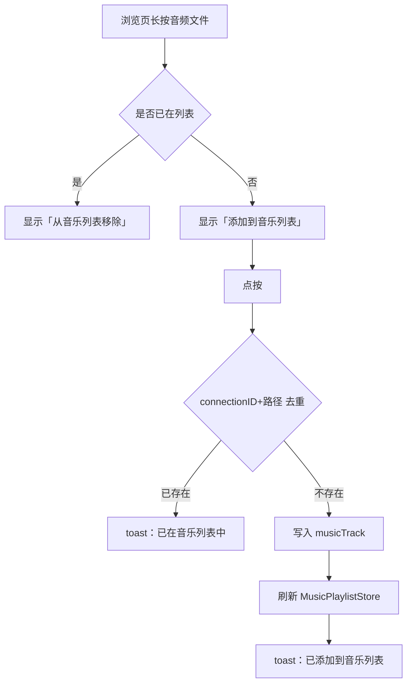
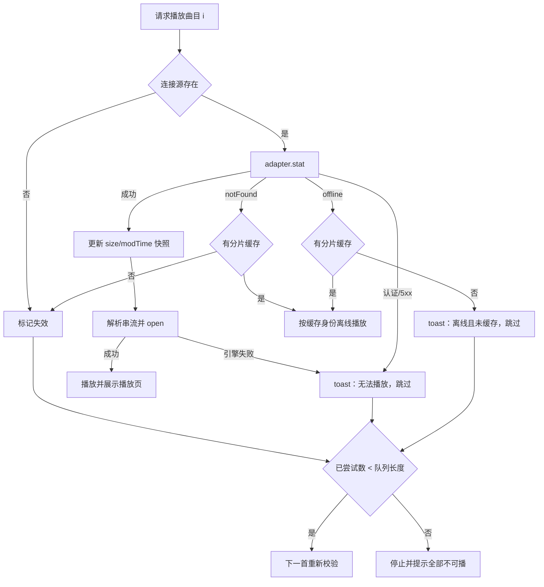

# MyHub iOS 音乐播放器需求文档

| 项目 | 内容 |
| --- | --- |
| 文档版本 | v0.1（待评审） |
| 编写日期 | 2026-11-26 |
| 项目代号 | myhub-ios |
| 关联文档 | 《MyHub iOS 原生应用需求分析文档 v1.2》§2.2 导航架构 / §2.5 阅读模块（IOS-202 音频播放）/ §2.11 体验细则 |
| 功能编号段 | IOS-801 ~ IOS-809 |
| 文档状态 | 草稿（未开始编码） |

---

## 1. 背景与目标

### 1.1 背景

当前音频文件只能「点开即播」：浏览页点击音频 → 全屏播放器，播完退出，不保留队列，也没有集中的音频入口。用户日常听歌需要在目录树里逐级查找文件，体验断层。

本期新增一个**音乐播放器**模块：在底部导航新增「音乐」页签，把散落在各连接源中的音频文件收集成一个**用户自建的播放列表**，并提供完整的播放页、队列控制与失效自动跳过能力。

### 1.2 目标

1. 底部新增「音乐」页签，作为音乐播放的唯一常驻入口。
2. 浏览页长按音频文件即可「添加到音乐列表」，形成用户自建歌单。
3. 复用现有播放内核（`PlayerCore`）与 mini 播放器，**不新建第二套播放链路**。
4. 曲目源文件失效（被删/改名/连接源移除）时不中断收听：提示后自动跳过。
5. 播放数据走现有边下边播分片缓存，已听过的内容可离线续播。

### 1.3 原始诉求映射

| # | 原始诉求 | 对应需求 |
| --- | --- | --- |
| 1 | 播放器样式参考设计稿（黑胶唱片风格） | IOS-804 |
| 2 | 浏览页长按音频 → 添加到音乐列表 | IOS-802 |
| 3 | 列表文件已不存在时提示并播下一首 | IOS-805 |
| 4 | 先出原型图 | 已完成（原型评审后作废，样式结论并入 §5.4） |
| 5 | 播放的文件缓存在本地 | IOS-806 |
| 6 | mini 播放器与视频共用一套 | IOS-807 |

### 1.4 名词定义

| 名词 | 说明 |
| --- | --- |
| 音乐列表 | 用户自建的音频播放队列，持久化在本地数据库，全局唯一（不做多歌单） |
| 曲目（Track） | 音乐列表中的一条记录：连接源 + 文件路径 + 冗余元信息 |
| 失效曲目 | 曲目指向的源文件已不可读（不存在 / 连接源被删 / 离线且无缓存） |
| 当前队列 | 播放中的曲目顺序快照，来源于音乐列表；支持随机与循环 |
| mini 播放器 | 现有全局悬浮播放条（`MiniPlayer`），视频与音频共用 |

---

## 2. 范围

### 2.1 本期范围（In Scope）

- 底部「音乐」页签与音乐主页（列表 / 空态 / 全部播放）。
- 浏览页长按菜单的「添加到音乐列表 / 从音乐列表移除」。
- 音乐列表的移除、清空、拖动排序、多选删除。
- 完整音乐播放页（黑胶样式）、播放队列抽屉、上一首/下一首/随机/循环。
- 曲目失效检测、提示与自动跳过。
- 播放缓存（边下边播分片）与已缓存标识。
- mini 播放器按媒体类型分流展开。

### 2.2 不在本期范围（Out of Scope）

- 多歌单 / 收藏歌单 / 智能歌单。
- 在线音乐平台接入、歌词（含滚动歌词、桌面歌词）。
- 音效均衡器、无缝播放（gapless）、淡入淡出。
- 睡眠定时器、听歌统计与推荐。
- 音乐文件元数据（ID3/FLAC tag）完整解析——本期仅解析「作者 - 标题」文件名约定。

---

## 3. 功能总览

| 功能编号 | 功能名称 | 优先级 | 说明 |
| --- | --- | --- | --- |
| IOS-801 | 音乐页签与音乐主页 | P0 | 底部第五个页签 + 列表/空态/全部播放 |
| IOS-802 | 添加到音乐列表 | P0 | 浏览页长按菜单入口 + 去重 |
| IOS-803 | 音乐列表管理 | P1 | 移除 / 清空 / 拖动排序 / 多选删除 |
| IOS-804 | 音乐播放与播放页 | P0 | 队列、切歌、随机循环、播放页 UI |
| IOS-805 | 失效曲目检测与自动跳过 | P0 | stat 校验 → 提示 → 下一首 |
| IOS-806 | 音乐缓存与离线播放 | P0 | 分片缓存、已缓存标识、离线兜底 |
| IOS-807 | mini 播放器复用与展开路由 | P0 | 音频 → 音乐页；视频 → 全屏 |
| IOS-808 | 数据模型与迁移 | P0 | `musicTrack` 表 + 迁移脚本 |
| IOS-809 | 音乐页交互与视觉细则 | P1 | 行高亮、均衡器动效、无障碍 |

---

## 4. 页面结构

### 4.1 导航位置

| 平台 | 变化 |
| --- | --- |
| iPhone（Compact） | 底部页签由 4 个变 5 个：阅读 / 浏览 / **音乐** / 浏览器 / 设置；置于「浏览」与「浏览器」之间 |
| iPad（Regular） | 侧边栏在「浏览」之后插入「音乐」；`AppTab` 新增 `.music` 分支 |
| 页签图标 | `music.note`（选中态 `music.note` + 主色） |

约束：

- 音乐页签与其他页签一样**常驻保活**（`RootView` 的 keep-alive 容器），切换页签不销毁列表滚动位置与播放页状态。
- 页签重复点击回到列表顶部（复用现有 `AppRouter.reselect` 机制）。
- 显示音乐 tab 时，mini 播放器与页签栏的叠放顺序保持现状（mini 在页签栏之上）。

### 4.2 音乐主页（列表态）

自上而下：

1. **大标题栏**：`音乐` + 右侧操作（随机播放全部、更多菜单：清空列表 / 移除失效项）。
2. **全部播放卡**：主色大播放按钮 + 「全部播放」+ 副标题「共 N 首 · 约 X 分钟」（时长未知时省略）。
3. **曲目列表**：每行
   - 左：48pt 圆角封面（无封面时按标题哈希取渐变色底 + 音符图标）；
   - 中：标题（`作者 - 标题` 文件名解析后的标题）+ 副标题「作者 · 格式 · 大小」；
   - 右：正在播放行显示跳动的均衡器动效 + 「正在播放」标签；其他行显示拖动手柄；
   - 正在播放行整行浅主色高亮 + 左侧 3pt 主色竖条。
4. **底部留白**：预留 mini 播放器 + 页签栏高度（复用 `bottomChromeHeight`），最后一行不被遮挡。

### 4.3 音乐主页（空态）

- 居中图标（圆底音符）+ 标题「音乐列表还是空的」+ 引导文案：「去『浏览』长按音频文件，选择『添加到音乐列表』」。
- 支持格式提示：MP3 / FLAC / M4A / WAV / APE / OGG / AAC。

### 4.4 音乐播放页

参考设计稿的**黑胶唱片**语言，与现有音频播放页保持同一套视觉：

| 区域 | 内容 |
| --- | --- |
| 顶部导航 | 收起（chevron.down）、收藏、更多 |
| 位置提示 | 「正在播放 · 音乐列表 i/N」 |
| 主体 | 封面模糊光晕铺底；黑胶唱片（封面圆形裁切 + 中心轴孔）+ 唱臂；播放时唱片 20s/圈匀速旋转，暂停即停 |
| 曲目信息 | 标题（大号）+ 作者 + 信息 chip：格式 / 大小 / 「已缓存」 |
| 工具行 | 随机、下载到本地（P2）、更多（属性 / 从列表移除 / 查看所在目录） |
| 进度条 | 已播/总时长，可拖动 seek；拖动时显示目标时间 |
| 主控制 | 随机 · 上一首 · 播放/暂停（主色大圆）· 下一首 · 队列 |
| 队列 | 点队列图标弹出底部抽屉：当前队列列表，点行切歌、左滑移除、顶部「清空」 |

交互约束：

- 播放页为全屏覆盖路由，**不随页签切换销毁**；向下拖拽或点收起回到音乐主页。
- 无封面时不渲染光晕，退化为纯色渐变底（暗色模式自动适配）。
- 播放页只在「音乐」上下文打开；从浏览页直接点开音频仍走现有播放器（不入队列）。

### 4.5 队列抽屉

- 复用现有底部抽屉组件与圆角/拖拽手感。
- 队列顺序 = 当前播放顺序（随机模式下展示实际随机顺序）。
- 操作：点行切歌、左滑移除（仅移出队列并同步移出音乐列表，需二次确认开关见 §5.9）、清空队列。

---

## 5. 功能需求详述

### 5.1 IOS-801 音乐页签与音乐主页

| 编号 | 需求 | 优先级 |
| --- | --- | --- |
| 801-1 | `AppTab` 新增 `.music`，iPhone `phoneTabs` 与 iPad 侧栏均包含 | P0 |
| 801-2 | 音乐主页展示曲目数量、总时长（可获取时）、全部播放入口 | P0 |
| 801-3 | 空态给出浏览页入口引导 | P0 |
| 801-4 | 列表数据变更（加入/移除/排序）实时刷新，无需手动下拉 | P0 |
| 801-5 | 页签保活，滚动位置与播放页状态不丢失 | P0 |
| 801-6 | 重复点击页签回到列表顶部 | P1 |

**数据来源**：`MusicPlaylistStore`（`ObservableObject` 单例），变更后发通知，浏览页星标/菜单文案与音乐页双向同步。

### 5.2 IOS-802 添加到音乐列表

**入口**：浏览页长按（或指针右键）音频文件的菜单。

| 编号 | 需求 | 优先级 |
| --- | --- | --- |
| 802-1 | `MediaType == .audio` 的文件菜单新增「添加到音乐列表」，图标 `music.note.list` | P0 |
| 802-2 | 已在列表中的文件显示「从音乐列表移除」（图标 `music.note.list`，destructive 样式） | P0 |
| 802-3 | 添加入口置于菜单靠前位置（紧跟「打开」），与「收藏」区分 | P0 |
| 802-4 | 去重键为 `(connectionID, filePath)`；重复添加提示「已在音乐列表中」，不产生重复行 | P0 |
| 802-5 | 添加成功轻提示「已添加到音乐列表」（复用浏览页 toast） | P0 |
| 802-6 | 多选模式操作栏新增「加入音乐列表」，批量加入并提示新增数量 | P1 |
| 802-7 | 不可添加：目录、非音频扩展名（菜单项不出现） | P0 |

**元信息快照**：加入时记录 `name / size / modTime / 连接源类型`，用于列表离线展示与失效判断基线。

### 5.3 IOS-803 音乐列表管理

| 编号 | 需求 | 优先级 |
| --- | --- | --- |
| 803-1 | 单条移除：行左滑「移除」，仅移出列表，不删除源文件 | P0 |
| 803-2 | 清空列表：更多菜单 → 「清空音乐列表」，二次确认；正在播放的曲目停止并退出播放页 | P1 |
| 803-3 | 拖动排序：长按行拖动，顺序持久化（`sortOrder`），重启后保持 | P1 |
| 803-4 | 多选删除：进入多选后可批量移除 | P1 |
| 803-5 | 移除当前播放曲目：队列中同步剔除，若为当前曲则自动切下一首；队列已空则停止播放 | P0 |
| 803-6 | 移除操作提供撤销（复用现有 undo toast，5s） | P2 |
| 803-7 | 「移除失效项」：一键清理已确认失效（stat 返回 notFound）的曲目 | P1 |

### 5.4 IOS-804 音乐播放与播放页

**播放链路**：复用 `PlayerCore` 单一实例。

```
音乐列表队列 → 取当前曲目 FileEntry
  → adapter.stat 校验（见 5.5）
  → PlaybackSourceResolver.makeRequest(connection:entry:)
  → PlayerCore.open(request)   // 与视频共用引擎、解码偏好、mini 播放器
  → CoverService.cover(forItem:)   // 封面 + 时长
  → NowPlaying 接管后台/锁屏/控制中心
```

| 编号 | 需求 | 优先级 |
| --- | --- | --- |
| 804-1 | 点行播放：以该行为起点，按当前队列顺序续播 | P0 |
| 804-2 | 「全部播放」：从第一首开始播整个列表 | P0 |
| 804-3 | 上一首 / 下一首：按队列顺序，边界行为遵循循环设置 | P0 |
| 804-4 | 播放模式：列表循环（默认）/ 单曲循环 / 随机；状态本地持久化 | P0 |
| 804-5 | 曲目播完（`state == .ended`）自动下一首；单曲循环时重播本曲 | P0 |
| 804-6 | 断点续播：进入曲目时按 `ReadingProgress` 恢复上次位置（>1s 且未完成） | P0 |
| 804-7 | 进度回写：沿用 `PlaybackProgressStore`（5s 节流 + 暂停/seek/退出强制） | P0 |
| 804-8 | 后台与锁屏：播放中进入后台不断播，控制中心/锁屏显示标题、作者、封面、进度、上一首/下一首 | P0 |
| 804-9 | 播放页显示「已缓存」chip：该曲目分片缓存已达完整文件大小时显示 | P1 |
| 804-10 | 倍速、音轨选择、字幕等视频专属控件在音乐上下文隐藏 | P0 |
| 804-11 | 音频文件若被判定为可解码失败（引擎报错），toast 提示「无法播放「xxx」」并跳过下一首 | P0 |
| 804-12 | 播放页可下拉收起回列表；mini 与播放页状态严格同源（同一 `PlayerCore`） | P0 |

### 5.5 IOS-805 失效曲目检测与自动跳过

**检测时机**：每次「准备播放某曲目」时（含点行、上一首/下一首、自动续播、随机切歌）。

| 编号 | 需求 | 优先级 |
| --- | --- | --- |
| 805-1 | 播放前 `adapter.stat(path)` 校验；成功则刷新曲目的 `size / modTime` 快照 | P0 |
| 805-2 | `stat` 抛 `notFound` / `invalidPath` → 判定失效 | P0 |
| 805-3 | 连接源记录已被删除（`Connection` 查不到）→ 判定失效 | P0 |
| 805-4 | 离线（`StorageError.offline`）且无可用分片缓存 → 判定「暂不可播」，**不**判定失效 | P0 |
| 805-5 | 失效处理：顶部浮层提示「‘xxx’已不存在，已自动播放下一首」，随后自动切下一首 | P0 |
| 805-6 | 连续失效全部队列（一轮遍历无一首可播）→ 停止播放，提示「列表内曲目均不可播放，请检查连接源或移除失效项」 | P0 |
| 805-7 | 一轮遍历内每首最多尝试一次，避免死循环；上限 = 队列长度 | P0 |
| 805-8 | **不自动删除**失效条目（离线/临时故障可恢复），仅在列表中标记灰色「已失效」徽标 | P0 |
| 805-9 | 失效条目不参与「全部播放」的时长统计 | P2 |
| 805-10 | 提示浮层 3s 自动消失，可叠加多条时只保留最新一条 | P1 |

**判定矩阵**：

| stat 结果 | 有缓存 | 处理 |
| --- | --- | --- |
| 成功 | — | 正常播放（走边下边播） |
| notFound / invalidPath | 有 | 按缓存身份离线播放，同时标记「源文件缺失」 |
| notFound / invalidPath | 无 | 失效 → 跳过 |
| offline（网络不可达） | 有 | 离线播放（离线模式） |
| offline | 无 | 暂不可播 → 跳过并提示「离线且未缓存」 |
| authenticationFailed / http 5xx | 任意 | 不可播 → 提示原因并跳过（不标失效） |

### 5.6 IOS-806 音乐缓存与离线播放

| 编号 | 需求 | 优先级 |
| --- | --- | --- |
| 806-1 | 播放沿用现有 `SegmentCache` 边下边播：按 Range 拉取并落盘分片，二次播放命中缓存 | P0 |
| 806-2 | 单曲分片缓存上限受「存储与缓存管理」总预算约束，LRU 淘汰 | P0 |
| 806-3 | 已完整缓存的曲目在断网时可正常播放与拖动 | P0 |
| 806-4 | 设置页缓存分区展示音频相关占用（见下） | P1 |
| 806-5 | 清理缓存不影响音乐列表本身，只影响离线可播性 | P0 |
| 806-6 | 关闭「内容缓存本地化」开关后不再写分片，仅在内存/临时缓冲 | P1 |
| 806-7 | （可选）整曲下载到本地，后续可离线不依赖分片；若实现则新增 `musicTracks` 缓存分区 | P2 |

**缓存分区**：P0 阶段无需新增分区——音频分片与视频共用 `MediaSegments`（`SegmentCache` 自管，占总预算 50%，含单文件 1/4 上限）。若 P2 实现整曲离线缓存，再新增 `musicTracks` 分区并按 2 的负幂次调整权重：

| 分区 | 现状权重 | P2 调整后 |
| --- | --- | --- |
| mediaSegments | 0.5 | 0.375 |
| musicTracks（新） | — | 0.125 |
| comicPages | 0.25 | 0.25 |
| thumbnails | 0.125 | 0.125 |
| novelChapters | 0.0625 | 0.0625 |
| novelIndexes | 0.03125 | 0.03125 |
| directoryListings | 0.03125 | 0.03125 |

### 5.7 IOS-807 mini 播放器复用与展开路由

| 编号 | 需求 | 优先级 |
| --- | --- | --- |
| 807-1 | mini 播放器只有一套实现（`MiniPlayer` + `PlayerPresenter`），音乐与视频共用，不新增音乐专属 mini | P0 |
| 807-2 | 音频播放时 mini 左侧为圆形封面（无封面则音符占位），失败时回退占位 | P0 |
| 807-3 | mini 标题区展示「标题 + 作者」（沿用 `NowPlaying.parseAuthorTitle`） | P0 |
| 807-4 | 点击 mini 标题/封面：音频 → 切到音乐页签并展开音乐播放页；视频 → 现有全屏视频播放页 | P0 |
| 807-5 | 音频上下曲按钮：点击 mini 的播放/暂停与关闭行为不变；音频补充「上一首/下一首」入口（mini 空间不足时收进更多菜单） | P1 |
| 807-6 | 视频 ↔ 音乐切换时 mini 形态自动切换，不出现两套并存 | P0 |
| 807-7 | 从音乐播放页收起 → 回列表 + mini 常驻，边播边浏览其他页签 | P0 |

### 5.8 IOS-808 数据模型与迁移

**表 `musicTrack`**（新增迁移 `v3_music_playlist`）：

| 字段 | 类型 | 约束 | 说明 |
| --- | --- | --- | --- |
| id | INTEGER | PK AUTOINCREMENT | 主键 |
| connectionID | INTEGER | NOT NULL | 连接源 ID；**不建外键**（连接源删除后保留条目） |
| filePath | TEXT | NOT NULL | 连接内虚拟绝对路径 |
| name | TEXT | NOT NULL | 文件名（含扩展名） |
| size | INTEGER | NOT NULL DEFAULT 0 | 加入时字节数（基线） |
| modTime | DATETIME | NOT NULL | 加入时修改时间（基线） |
| sourceType | TEXT | NOT NULL | 连接源类型（local/webdav/smb） |
| sortOrder | INTEGER | NOT NULL DEFAULT 0 | 用户排序序号，越小越靠前 |
| addedAt | DATETIME | NOT NULL | 加入时间 |

索引：

- `UNIQUE(connectionID, filePath)` —— 去重。
- `INDEX(sortOrder)` —— 列表排序。

**模型**：`MusicTrack: Codable, FetchableRecord, PersistableRecord`，提供 `entry() -> FileEntry` 供 stat / 播放 / 封面复用。

**Store**：`MusicPlaylistStore`（`@MainActor` 单例，`ObservableObject`）

- `tracks`：按 `sortOrder, addedAt` 升序。
- 方法：`reload` / `add(connection:entries:)` / `remove(track:)` / `removeAll` / `move(fromOffsets:toOffset:)` / `contains(connectionID:path:)` / `paths(for:)`。
- 变更后发 `MusicPlaylistDidChange` 通知，浏览页菜单文案与音乐页同步刷新。

### 5.9 IOS-809 交互与视觉细则

| 编号 | 需求 | 优先级 |
| --- | --- | --- |
| 809-1 | 去掉曲目：默认不弹确认；「清空列表」必须二次确认 | P0 |
| 809-2 | 左滑移除队列曲目时是否同步移出音乐列表，由设置项「队列与列表联动」控制（默认联动） | P2 |
| 809-3 | 列表行支持 VoiceOver：读出「标题，作者，格式，正在播放」 | P1 |
| 809-4 | 均衡器动效仅在正在播放行显示，暂停时静止（避免无意义重绘） | P1 |
| 809-5 | 封面加载失败显示渐变色占位，不出现空白行 | P1 |
| 809-6 | 暗色模式下播放页光晕降低不透明度，黑胶纹理保持可见 | P1 |
| 809-7 | 大列表（>500 首）滚动保持 60fps：封面异步加载 + 行视图轻量化 | P0 |

---

## 6. 关键流程

### 6.1 添加曲目



### 6.2 切歌与失效跳过



### 6.3 mini 展开分流


---

## 7. 非功能需求

| 类别 | 要求 |
| --- | --- |
| 性能 | 冷启动新增页签无额外 IO；列表 500 首滚动 60fps；切歌（含 stat）本地 < 300ms，网络源 < 2s 出画面/出声 |
| 内存 | 封面下采样到行高 2 倍像素；播放页不持有全尺寸封面副本；不预加载整首音频 |
| 耗电 | 播放页旋转动画仅在播放态运行；列表不常驻定时器；后台播放由 `AVAudioSession` 统一管理 |
| 稳定性 | 失效跳过不死循环；数据库写失败不崩溃（toast 提示）；Connection 删除后音乐页不崩溃 |
| 兼容 | iOS 最低版本与主工程一致；iPhone / iPad 自适应；深浅色与现有主题 token 一致 |
| 可访问性 | 动态字体支持；VoiceOver 行读法；主控制按钮 44pt 点击区 |
| 数据安全 | 仅记录路径与元信息，不缓存凭据；分片缓存落 `Caches`，可被系统回收 |

---

## 8. 影响面与复用

| 模块 | 改动性质 | 说明 |
| --- | --- | --- |
| `AppTab` / `RootView` | 修改 | 新增 `.music` 分支、页签图标与保活容器；iPad 侧栏插入 |
| `BrowseDirectoryView` | 修改 | 音频文件长按菜单新增两项；多选操作栏新增批量加入（P1） |
| `BrowseDirectoryViewModel` | 修改 | 提供 `addToMusicList(entries:)` 等封装与 toast |
| `MiniPlayer` / `PlayerPresenter` | 修改 | 点击展开按 `isAudioOnly` 分流到音乐页；其余外观不动 |
| `CacheManager` | 不改（P2 改） | P0 复用 `MediaSegments`；P2 整曲缓存才新增分区 |
| `AppDatabase` | 修改 | 新增 `v3_music_playlist` 迁移 |
| `PlayerCore` | 不改 | 直接复用，队列逻辑在音乐模块内实现 |
| `NowPlaying` | 不改 | 复用后台音频与锁屏信息 |
| `FavoritesStore` | 不改 | 收藏与音乐列表相互独立 |

**新增文件（预计）**：`MusicTrack.swift`、`MusicPlaylistStore.swift`、`MusicHomeView.swift`、`MusicPlayerView.swift`、`MusicPlaybackController.swift`（队列/切歌/失效跳过）、`MusicQueueSheet.swift`。

---

## 9. 验收标准

| # | 前置 | 操作 | 预期 |
| --- | --- | --- | --- |
| AC-01 | 音乐列表为空 | 打开音乐页签 | 显示空态与浏览页引导文案 |
| AC-02 | 有音频文件 | 浏览页长按音频 | 菜单出现「添加到音乐列表」；点按后 toast 提示且音乐页出现该曲目 |
| AC-03 | 曲目已在列表 | 再次长按同一文件 | 菜单显示「从音乐列表移除」，点按后列表移除，源文件不被删除 |
| AC-04 | 列表有 3 首 | 点第 2 首 | 从第 2 首开始播放，播放页正确显示标题/作者/时长，mini 同步出现 |
| AC-05 | 播放中 | 切到浏览页 | 音频不中断，mini 常驻可暂停/播放 |
| AC-06 | 音频 mini 显示中 | 点 mini 标题 | 切到音乐页签并展开音乐播放页（非视频全屏） |
| AC-07 | 队列第 2 首源文件被删除 | 播完第 1 首自动下一首 | 顶部提示「‘xxx’已不存在，已自动播放下一首」，随后播放第 3 首 |
| AC-08 | 队列全部源文件被删除 | 点「全部播放」 | 遍历一轮后停止，提示「列表内曲目均不可播放」 |
| AC-09 | 断网，某曲已完整缓存 | 播放该曲 | 正常播放并可拖动，不报错 |
| AC-10 | 断网，某曲未缓存 | 播放该曲 | 提示「离线且未缓存」并跳过，不标记为已失效 |
| AC-11 | 播放中 | 锁屏 / 控制中心 | 显示标题、作者、封面与进度；可用上一首/下一首、拖动进度 |
| AC-12 | 列表 10 首 | 拖动调序后重启 App | 顺序保持；第 N 项 `sortOrder` 持久化 |
| AC-13 | 播放中移除当前曲 | 左滑移除 | 自动切下一首；队列为空时停止播放并回到列表 |
| AC-14 | 深浅色切换 | 进入播放页 | 黑胶光晕与文字对比度可读，无白底黑字/黑底黑字 |

---

## 10. 里程碑

| 阶段 | 内容 | 交付物 |
| --- | --- | --- |
| M1 数据层 | 表结构 + 迁移 + Store + 单元测试（去重/排序/移除） | 可读写音乐列表 |
| M2 入口与列表 | 音乐页签、主页/空态、浏览页长按入口 | 可收集并管理曲目 |
| M3 播放 | 队列控制、播放页 UI、mini 分流、断点续播、后台/锁屏 | 可完整听歌 |
| M4 稳定性 | 失效检测与跳过、离线兜底、性能与暗色适配、验收 | 可发布 |

---

## 11. 风险与开放问题

| # | 风险 / 待定 | 影响 | 建议 |
| --- | --- | --- | --- |
| R1 | 黑胶旋转 + 光晕模糊在旧机型可能掉帧 | 播放页卡顿 | 提供「精简播放页」开关；低电量模式关动画 |
| R2 | 每次切歌 `stat` 增加一次网络往返 | 弱网切歌变慢 | 本地源跳过 stat；远程源并行 stat 与串流解析 |
| R3 | 分片缓存被系统回收后「已缓存」标识失真 | 预期落空 | 标识以分片索引实际完整度为准，进入播放页时复查 |
| R4 | 音频格式覆盖不足（APE/WMA/DSD） | 部分曲目无法播 | 复用 VLC 软解分支；失败时明确提示并跳过 |
| R5 | 连接源删除后大量条目失效 | 列表变脏 | 提供「移除失效项」批量清理 |
| Q1 | 是否需要多歌单？ | 影响表结构 | 本期明确单列表，后续可加 `playlistID` 扩展 |
| Q2 | 队列左滑是否同步移出列表？ | 交互歧义 | 默认联动，P2 提供开关 |
| Q3 | 是否需要歌词？ | 范围膨胀 | 本期不做，播放页预留工具行扩展位 |

---

## 12. 变更记录

| 版本 | 日期 | 变更 |
| --- | --- | --- |
| v0.1 | 2026-11-26 | 首版：确立音乐页签、列表收集、播放页、失效跳过、缓存复用、mini 共用六项核心能力与验收标准 |

